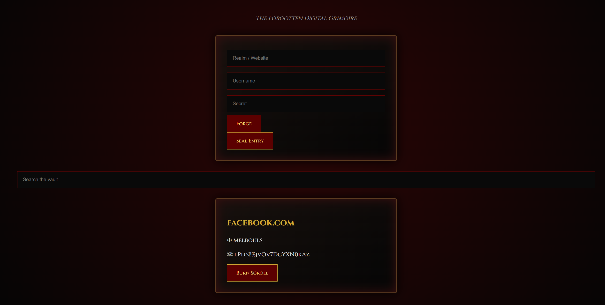
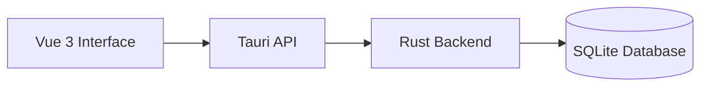

# CyberVault


CyberVault is a desktop password manager built with Rust, Tauri, Vue 3 and SQLite.

The application provides a local vault to store and manage credentials with a dark gothic-inspired interface.

The goal of this project is to learn Rust desktop development, Tauri architecture and communication between a frontend and a native backend.

---

## Features

- Add and delete password entries
- Store website, username and password
- Local SQLite database
- Password generator
- Offline usage
- Gothic dark themed interface

---

## Preview



Available screenshots:

```
docs/
├── home.png
├── vault.png
└── generator.png
```

---

## Architecture



---

## Project Structure

```
CyberVault

├── src
│   ├── App.vue
│   ├── main.js
│   └── assets
│       └── style.css
│
├── src-tauri
│   ├── src
│   │   ├── main.rs
│   │   ├── lib.rs
│   │   ├── database.rs
│   │   └── models.rs
│   │
│   └── Cargo.toml
│
└── package.json
```

---

## Technologies

### Frontend

- Vue 3
- JavaScript
- CSS

### Backend

- Rust
- Tauri 2

### Database

- SQLite
- Rusqlite

---

## Installation

### Requirements

- Node.js
- Rust
- Cargo

Check your versions:

```bash
node --version
rustc --version
cargo --version
```

---

## Install dependencies

```bash
npm install
```

---

## Run the application

```bash
npm run tauri dev
```

---

## Database

CyberVault creates a local SQLite database:

```
vault.db
```

Current structure:

```
vault

├── id
├── name
├── login
└── secret
```

---

## Future Improvements

- Encrypt stored passwords
- Master password authentication
- Password categories
- Search system
- Auto-lock vault
- Export/import vault

---

## GitHub

https://github.com/molosso